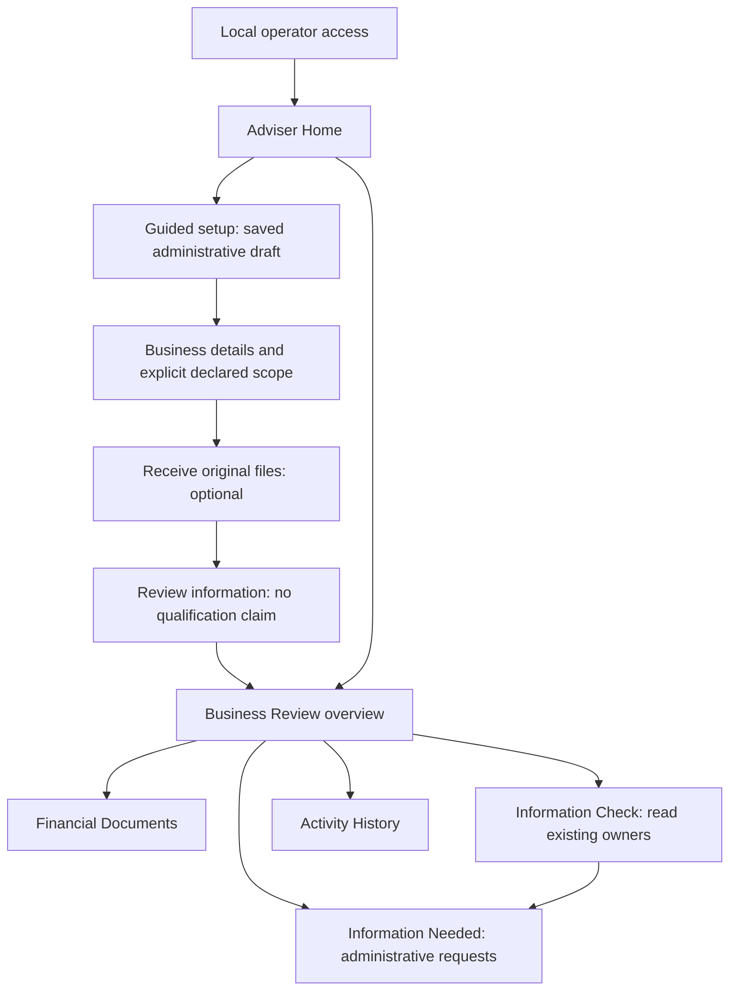

# Profit Doctor v2.57 — Hybrid Adviser Experience Architecture

## 1. Executive design summary and authority

**Status: proposed engineering contract for architectural approval; design only.** The only authorised change in this task is this document. No implementation, migration, test change, deployment, staging, commit or push is authorised. Requirements below describe future work, not capabilities already delivered.

Inspection baseline: `37a9e63617c4764383f36bd638c59ba1fd095ec3`. HEAD, local `main`, local `origin/main` and independently queried remote `main` match; the working tree was clean before this document. Frozen v2.56 qualification is 1,333 local PASS, nine legitimate live-only skips, 784/784 live PostgreSQL PASS and four CI jobs PASS. The product owner reports successful hands-on use. No qualification suite was rerun for this architecture task and no usability observation beyond the supplied feedback is claimed.

Deliver a **hybrid guided setup plus adviser dashboard** for the existing local, single trusted operator application. Replace the technical single-column presentation with clear task navigation, structured tables, meaningful save feedback and an Information Check that explains the limits of the selected evidence. Preserve every analytical and evidence-governance owner.

The smallest coherent release includes durable incomplete setup, review reopening, document receipt presentation, existing readiness presentation, administrative information requests, activity history and safe session/selection restoration. It does not connect new analytical workflows or publish reports. A more approachable interface must not imply stronger evidence.

Three architectural recommendations require approval with this contract:

1. Add a narrowly administrative, append-only setup-draft owner because the frozen engagement contract cannot represent incomplete scope. Propose a forward migration `0021_adviser_setup`; no migration exists or is executed in this task.
2. Add authenticated session-resume, sign-out and bounded session lifetime to the local HTTP host. Do not store the access code or authentication/CSRF tokens in browser persistent storage.
3. Keep business creation limited to existing explicit operator grants. The ordinary interface selects an unused preauthorised client identity; it cannot generate a new authorised client or expand grants.

## 2. Verified frozen implementation and source map

The following findings are established by repository inspection, rather than inferred from the existence of analytical domain models.

| Source | Existing capability | Actual limitation |
|---|---|---|
| `scripts/run_workspace_v256.py` | Explicit local SQLite database and original-file store; repeated `--client` grants; optional read-only legacy registry; loopback Uvicorn; OS-derived actor; engine disposal | No multi-user authentication, trust enrolment, background analysis or cloud deployment. Requires migration head 0020. |
| `workspace/app.py` | FastAPI routes for clients, engagements, original receipts, registration associations, requests, readiness and legacy coverage | No home summary, incomplete setup, owner-discovery UI, session introspection, sign-out or expiry mechanism. |
| `workspace/index.html`, `ui.js`, `ui.css` | Working forms, downloads, current/historical controls, review reopening | Long page; JSON cards; manual owner IDs; generic save/load message; no route/selection restoration. |
| `workspace/contracts.py` | Typed administrative scope; OPEN/CLOSED engagement revisions; receipts; four request statuses | Every engagement requires title, entity, ledger and ordered dates. No DRAFT engagement or setup-step state. |
| `workspace/service.py` | Client grants; fixed engagement scope; sequential revisions; replay/digest checks; atomic audit with writes; caller-owned sessions | No general adviser note, priority, decision or analytical orchestration writer. `engagements()` orders by creation, not recent user access. |
| `workspace/storage.py` | Content-addressed exact original bytes; SHA-256/size validation; bounded receipts; filename/path checks; orphan reporting | Receipt is not normalization, authentication or accounting-pack validation. No automatic deletion. |
| `workspace/readers.py` | Reads completed immutable registrations with matching client/bytes; exact owned readiness scope/currentness; separately labelled legacy coverage | Registration proves neither entity/period semantics nor source authority. Launcher trust is UNKNOWN by default; current readiness may legitimately refuse. |
| `persistence/workspace_schema.py`, migration 0020 | Seven scoped workspace tables; FKs, revision/replay uniqueness; immutable application history | No setup draft or completion state. Application immutability is not resistance to an administrator editing the database. |
| `reasoning/production_evidence/readiness.py` | Nine domains; statuses; selected owner references; gaps/conflicts; current validation; retained historical results | Evidence capability readiness is not an economic conclusion, whole-company score or all-data completeness assertion. |

Paths under `workspace/`, `persistence/` and `reasoning/` above are relative to `profit_doctor/`. Reuse the frozen architecture audit and engineering document as context; do not revise them to imply newly delivered capabilities.

## 3. User journeys

### 3.1 Return to work

Open the local application. Before showing any business data, attempt authenticated session restoration. If valid, show Adviser Home and restore a remembered authorised review/tab when it still exists. If absent/expired, show Operator Access. After successful sign-in, resolve the saved selection again through scoped APIs. A missing/foreign selection returns safely to Home without revealing its contents.

Home displays authorised businesses, a name search, saved reviews, incomplete setup and Information Needed. Separate “recently opened in this tab” from server-recorded creation/activity; there is no existing durable last-opened timestamp. Do not imply user access was audited merely because a row appears in a recent list.

### 3.2 Guided setup

**Stage 1 — Business details.** Select an authorised existing business or add a name using an unused preauthorised client identity. Enter review title and dates. Explicitly choose an existing administrative entity/ledger pair from that business's prior reviews, or create a new review-only administrative scope. Explain that this does not verify legal identity, source scope or population equivalence. Generate review/draft identities safely; hide internal IDs by default.

Do not infer entity = client, ledger = filename, currency from document appearance, or year-end from an uploaded file. Existing administrative scope choices require an explicit adviser selection. A new entity/ledger identifier is an administrative workspace identity, not a qualified source mapping. Subsequent analytical integration would require independently established exact source correspondence.

After a business is selected/created, Save and exit can persist partial title/date/scope fields in a draft. No draft may be stored before client ownership is established. Continue requires complete valid scope and creates the existing strict engagement once, linked to the draft. The engagement's scope is then fixed.

**Stage 2 — Upload financial documents.** Receive original files through the frozen receipt route. Show per-file outcomes and the existing size limit; files are owned by the linked engagement. Allow Continue without documents, with a clear “No documents uploaded yet” notice. Do not require verified evidence to finish administrative setup. Back retains saved work and original receipts; it cannot change a materialised review's fixed scope.

**Stage 3 — Review information.** Show business, review title, declared scope/dates and uploaded-file count. State “Files received; evidence checks and analysis have not been completed.” Continue to workspace marks only setup complete, never evidence qualified. Saved incomplete setup remains resumable after reload and process restart.

All stages have a three-step progress indicator, Back, Continue and Save and exit. Editing fields remains explicitly unsaved until a successful save. Navigation away from unsaved edits requires Save, Discard or Stay. No hidden autosave or misleading success banner.

### 3.3 Existing review

Reopen an existing frozen v2.56 review directly in Overview; it does not require a new wizard or duplicate engagement. Old records retain OPEN/CLOSED and all revisions. No backfill declares historical setup complete or evidence checked. A linked unfinished new draft exposes Resume setup alongside the existing review.

Switching business/review clears all visible data, loaded details and in-memory caches before loading the next scope. Unsaved-edit confirmation comes first. Late responses from the previous selection must not render in the new review.

### 3.4 Ask for information

From Overview or Information Check, open Information Needed with an editable question and evidence requirement. A domain-specific suggested requirement is explanatory text, not a conclusion that receiving a named file will qualify that domain. Create the existing administrative request; show author, dates, status and history. Associate only this engagement's receipts. Information Received requires files; Reviewed requires attributable rationale. Neither action authenticates evidence.

## 4. Navigation model and screen inventory

Use a persistent product header, Adviser Home link, business/review breadcrumb, clear current scope, section navigation and Sign out. Use fragment-based routes initially so refresh and browser Back/Forward do not require a new static-server routing architecture. Fragments contain only section and opaque selection identifiers, never names, source paths, hashes, financial values or secrets; they do not grant access.

| Screen/section | v2.57 treatment | Content and actions |
|---|---|---|
| Operator Access | Implement | Local code entry; safe paste; explanation of local access; generic refusal. |
| Adviser Home | Implement | Business search, review lists, incomplete setup, reopen/start review, outstanding requests. |
| Guided Setup | Implement | Three stages, durable drafts, explicit saves and administrative completion. |
| Overview | Implement | Review status/scope, uploaded-file count, outstanding requests, setup status and next administrative steps. No financial KPIs or readiness percentage. |
| Financial Documents | Implement | Receipt table, version/replacement detail, original download, selected registration detail. |
| Information Check | Implement | Existing selected readiness domains and precise missing/conflicted/current/historical explanations. |
| Information Needed | Implement as accessible subordinate task section | Create/list/filter requests, associate received files, review/withdraw with rationale. |
| Activity History | Implement | Attributable chronological workflow events and immutable revisions; expandable prior/result values. |
| Business Analysis | Defer; hide from primary navigation | No new analytical execution or engine-result publication in this release. Explain this boundary in a small Capabilities panel if needed. |
| Adviser Review | Defer as a decision section | Existing information fulfilment review is available; canonical ACCEPT/INVESTIGATE/REJECT decisions are not integrated here. |
| Client Report | Defer; hide from primary navigation | No export, publication, client portal or report-generation claim. |

Information Needed must not be buried inside the deferred Adviser Review section. Closed reviews remain viewable and require explicit reopening before writes. Search/filtering is limited to authorised loaded names/titles, with empty/error/loading states and no cross-client search endpoint.

## 5. Terminology and evidence-state presentation

Presentation labels never rewrite stored enums or promote their meaning. Technical Details retains exact original values and identities.

| Frozen term/value | Adviser wording | Qualification boundary |
|---|---|---|
| Engagement | Business Review | Administrative review owner, not a newly qualified company scope. |
| Evidence inventory | Financial Documents | Received originals; some may be non-financial supporting documents. |
| Receipt | Uploaded File | Exact retained bytes only. |
| Governed readiness | Information Check | Only explicitly selected scoped evidence. |
| Missing information | Information Needed | Administrative questions/requests. |
| Immutable workflow history | Activity History | Append-only application history, not administrator-proof storage. |
| Request OPEN | Information requested | No evidence received/qualified is implied. |
| EVIDENCE_RECEIVED | Information received | Receipt associations only. |
| FULFILMENT_REVIEWED | Request reviewed | Adviser reviewed the supplied information; not independently verified/complete. |
| WITHDRAWN | Request withdrawn | Rationale retained; not qualified or resolved evidence. |
| Engagement OPEN/CLOSED | Review open/closed | No readiness or analytical promotion. |
| NOT_PROVIDED_TO_WORKSPACE / null assessment | No assessed information selected for this review | Does not prove no verified information exists elsewhere. |
| Readiness VERIFIED | Evidence prerequisites satisfied for this selected capability | Display domain, scope, date and currentness; not a generic verified-file or company badge. |
| DECLARED | Declared; not verified | Human declaration remains distinct from independent source evidence. |
| PARTIAL | Partially supported | Show missing prerequisites; never extrapolate. |
| INSUFFICIENT | More evidence required | Do not equate to zero, false, no risk or no opportunity. |
| NOT_PROVIDED | Required evidence not provided to this assessment | Distinguish from an unselected assessment and from provider unavailable. |
| CONFLICTED | Conflicting evidence or changed basis | Current capability remains refused. |

The suggested blanket wording “No verified information available” is not safe for an unselected workspace owner: it implies a claim about the whole business. Use the narrower mapping above. Preserve FULL/PARTIAL/UNAVAILABLE/N/A distinctions wherever an existing provider supplies them; do not invent conversions between those states and readiness enums.

Keep separate columns/detail statements for received, registered, source authenticated, reconciled, qualified and analysis available. No single progress bar or “verified” icon subsumes them. v2.56 registration references establish matching immutable registered bytes, not file-level source authentication. Where no owner can establish a file-level state, display “Not established here”; do not borrow a domain-level VERIFIED status.

## 6. Visual design system

Use the existing Profit Doctor wordmark, system fonts and locally served assets. No remote fonts, tracking, decorative charts or illustration dependency. Extend HTML/CSS/JavaScript in bounded modules rather than introduce a new frontend framework/build pipeline.

| Element | Proposed design |
|---|---|
| Colour | Navy `#17394B` header/navigation; teal `#205C74` primary action; light `#F2F5F7` page; white surfaces; dark `#172B3A` text. All actual combinations require contrast testing. |
| Typography | System sans-serif; 16px base and 1.5 line height; 24–30px main titles; tabular numerals only for dates/counts. No condensed technical text as primary content. |
| Layout | 220–240px desktop sidebar, fluid main panel capped around 1280px, 24px content gutters, 8px spacing scale, restrained 8px corners. |
| Home/Overview | Small administrative summary cards and recent/outstanding lists; no economic-value cards. |
| Tables | Proper headings; filename/title as primary link; comfortable rows; explicit actions; sticky header where it does not obscure keyboard focus. |
| Status | Text plus optional icon/colour. Neutral for unassessed, amber for evidence needed, distinct conflict treatment. Green only for the precisely named state an owner establishes. |
| Save feedback | Prominent persistent inline confirmation with operation, review and revision/time; screen-reader status announcement. Errors remain until addressed. |
| Details | Native accessible disclosure for IDs, SHA-256, schema version, exact provider codes and raw documents; closed by default. |
| Responsive | At desktop use sidebar; below approximately 900px use an accessible navigation disclosure. At 320 CSS pixels use stacked content; wide data tables may have labelled horizontal scrolling. |

Target WCAG 2.2 AA for the implemented local experience: semantic landmarks, keyboard operation, visible/unobscured focus, labelled controls/errors, usable zoom/reflow, non-colour status communication and announced status messages. Prefer 44px controls as a usability target; do not conflate that preference with every AA minimum. Allow access-code paste and accessible authentication. Any session time limit requires warning and an accessible extension/reauthentication path preserving server-saved work. Reference: [W3C WCAG 2.2 quick reference](https://www.w3.org/WAI/WCAG22/quickref/). This is a qualification target, not a certification claim.

## 7. Financial Documents and Information Check

### Documents

Show filename, upload date/time with timezone, filename-derived type clearly labelled as such, declared category, received status, separately established registration/verification state, replacement/predecessor and Download original. Content type or authenticity is not inferred from an extension. Proposed categories (Accounting pack, General ledger, Sales records, Receivables, Supporting information, Other) remain adviser declarations using existing bounded `source_role`; no account classification or intake parser is selected automatically.

Every file gets its own success/failure outcome. A partially successful batch must preserve successful receipts and report remaining failures without claiming the whole batch saved. Changed bytes, missing storage and unsafe paths remain errors, not “not provided” readiness. No browser preview of untrusted uploaded HTML/script content. No delete-original capability. No arbitrary automatic registration; exact association is an advanced existing-owner operation only.

### Information Check

Use a static governed display registry for the nine frozen domains: Core accounting evidence; Monthly revenue evidence; Monthly Contribution 0 evidence; Contribution 0 margin evidence; Receivables snapshot evidence; Receivables absence evidence; Revenue trajectory evidence; Contribution 0 trajectory evidence; Receivables lifecycle evidence. Contribution 0 remains Contribution 0, with explanation; never rename it gross profit.

Each card shows the domain, selected scope/date, current/historical/unselected/unavailable state, provider-owned status, known missing prerequisites/conflicts, suggested information to request and limitations. No numerical/composite score. Use existing `missing_prerequisites`, `conflicts`, `capabilities_refused`, `capabilities_unlocked` and `limitations`; never call `assess()` merely to populate a screen.

For an empty selection say “No assessed information selected for this review. Uploads alone do not run evidence checks.” General guidance is labelled “Typical information needed”, not an authoritative case-specific gap or promise that a file will unlock the capability. Unknown future codes display a conservative untranslated detail with “Further evidence review required”; they do not imply availability.

Differentiate: no owner selected; integration/reader unavailable; assessment unavailable; current revalidation refused; scoped evidence conflicted; retained historical result. A historical badge and timestamp remain prominent even when its stored status is VERIFIED. Never retry a rejected current read as historical silently. Current trust unavailable in the default local launcher remains a legitimate refusal; the UI cannot enrol issuers or authenticate sources.

Offer Request information as an administrative action. Whether evidence could unlock a capability is conditional on its governed contract and current trust, never guaranteed. Do not fabricate a checklist of completed semantic prerequisites from uploads, totals or row counts.

## 8. API reuse and feature gap matrix

All paths below are local HTTP routes, not new public APIs. Every new route remains under the same operator/grant/Host/Origin/CSRF boundary.

| Feature | Existing API / persistence | Required work / missing contract | Security, tests and dependency | v2.57 decision |
|---|---|---|---|---|
| Home/business search | `GET /clients`; existing Client rows/grants | New structured UI; bounded read-only summary for reviews/requests/drafts | Server-side grant filtering; foreign/grant-revocation/empty tests; no global search | Include |
| Add business | `POST /clients`; `create_client()` | Select an unused preauthorised identity; name/currency form; hide IDs | Cannot expand grants; no remaining grant gives a clear refusal | Include within grants |
| Review list/reopen | `GET /clients/{c}/engagements`; engagement/revision tables | Name/date/status list; explicit selection and routes | Validate remembered IDs every time; Back/Forward and stale-response tests | Include |
| Guided partial setup | No draft contract; strict EngagementRevision | New scoped administrative draft/revisions; two-phase wizard ownership | No fake scope; revision/replay/rollback/restart tests; proposed migration 0021 | Include, subject to contract approval |
| Create/link review | `POST /clients/{c}/engagements` | Administrative coordinator links a valid strict review to draft once | Atomic DB transaction; exact same-client linkage; replay cannot duplicate review | Include |
| Upload/version/download | Existing receipts POST, original GET; receipt/store | Structured table and per-file confirmation; preserve raw-byte contract | 50 MiB, altered bytes, hostile/unicode filenames, wrong engagement, attachment tests | Include |
| Registration detail | Existing registration POST / inventory references | Advanced details only; no new automatic route | Matching bytes/client retained; no authority uplift | Include existing association only |
| Information Check | Existing readiness GET; existing governed owners/readers | Static terminology/prerequisite presentation; no new assessor | Compare displayed state with exact provider result; current/historical/refusal tests | Include presentation only |
| Discover analytical/readiness owners | No dedicated discovery route; reader needs explicit run/owner IDs | New integration and trust-resolution contract would be needed | Must not scan/select “latest” by client or guess semantic scope | Defer; preserve advanced explicit selections |
| Information Needed | Existing requests POST; response/history from workspace GET | List/filter/detail/edit UI; existing question/evidence/rationale fields | Allowed transitions, optimistic revisions, scoped receipts, attribution | Include |
| Free-form adviser notebook | No note history contract | Separate append-only domain would be needed | Avoid injecting opinion into facts/readiness | Defer; existing request review rationale only |
| Activity History | Existing workspace GET/history audit | Plain event labels, revision detail, before/result disclosure | No editing/deleting history; escape all data | Include |
| Session restore/sign-out | Existing `POST /session`; process-local cookie/token | Authenticated introspection, revocation and timeout host contract | CSRF recovery only after valid cookie; expiry/restart/grant/refusal tests | Include |
| Business Analysis | Domain engines exist, no workspace execution/publication route | Separate qualification/orchestration/result contract | No legacy-to-canonical authority substitution | Defer |
| Adviser Decision | Canonical priority/decision exists outside workspace | Separate authenticated scoped decision API/UI integration | Human authority, immutable assessment/decision basis | Defer |
| Client Report | Legacy product projection is not governed publication | Separate report/publication contract | No unsupported financial claims or client access | Defer |

The home summary is read-only and administrative: review identity/title/scope/status, latest existing workflow activity, scoped request counts and linked draft progress. Bound results (proposed maximum 50 rows per page), enforce grant scope before aggregation and avoid reading/hashing every original just to render Home. Existing receipt-integrity checks remain in inventory/download; do not cache those checks as assurance. “Outstanding” means OPEN or EVIDENCE_RECEIVED requests awaiting administrative review; WITHDRAWN is separate from reviewed. No financial rollup or priority ranking.

## 9. Durable setup and persistence contract

Reusing `OPEN` as “incomplete setup” is insufficient: Scope is mandatory and immutable, and OPEN also denotes legitimate existing reviews. Do not relax frozen contracts, insert placeholders for required scope, or store incomplete sensitive forms solely in browser localStorage.

Propose an isolated `SETUP-DRAFT-2.57` contract with draft identity, client identity, schema version, positive sequential revision, optional partial fields, step, lifecycle, creation/update timestamps, attributable actor, optional linked engagement and immutable predecessor. Draft fields are administrative; no financial values, readiness flags or verified source declarations. Client ownership is mandatory and cannot change in place.

Proposed lifecycle: DRAFT; REVIEW_CREATED; COMPLETE; CANCELLED. These describe wizard work only. COMPLETE is not a new engagement status, evidence state or approval. Persist steps 1–3 separately from lifecycle. Server validation rejects invalid combinations and reversed dates once both are supplied. After linkage, draft scope must agree with the fixed engagement; changing scope requires a new draft/review. Cancel retains revisions and any originals already owned by a created review; no cascade deletion.

Propose three narrowly administrative tables, `workspace_setup_draft`, `workspace_setup_revision` and `workspace_setup_review_link`, following existing identifier/text-document/timestamp patterns. Stable table: immutable draft/client identity and creation timestamp. Revision table: immutable revision identity, same-client draft FK, sequential uniqueness, positive revision CHECK, schema version/document, actor/time, event type, previous revision, idempotency key and payload digest. Unique `(client_id, request_key)` plus replay validation prevents operation reuse; predecessor relationships cannot cross draft/client scope. The link table has same-client draft and engagement FKs, uniqueness per draft and per engagement, and attributable creation metadata. It is inserted once, never retargeted; revisions carry the corresponding linked identity for validation. This small third table avoids mutating a supposedly immutable draft owner to attach a later-created review. Typed service validation additionally enforces lifecycle/link consistency.

Each draft revision is its attributable audit event. Do not invent an unaffiliated reasoning node simply to reuse analytical audits; existing workspace audit requires an engagement before it can be used. Review creation continues to write frozen workspace audit. Draft materialisation and linkage are coordinated in the caller-owned transaction, preserving both histories atomically. Services do not commit/close the caller session; failed validation/rollback removes the new draft/review references together.

Draft HTTP proposals: scoped list/read and revision save under `/clients/{c}/setup-drafts`; explicit scoped review materialisation and setup completion actions under the selected draft. Preserve expected-revision checks, bounded idempotency keys and generic foreign-object refusals. Client cannot supply actor, grants, authenticated/qualified flags or arbitrary linked engagement. A replay of the same materialisation returns the original linked review; changed payload, stale revision or foreign linkage refuses.

Migration proposal: forward `0021_adviser_setup`, following `0020_engagement_workspace`, under the 32-character Alembic limit. Reuse the portable preserved-fixture loader. Frozen migrations stay unchanged. Existing reviews/receipts/readiness/audits need no backfill. Downgrade removes new setup records/history intentionally, retains all 0020 and analytical records and original files, and does not manufacture a setup status on re-upgrade. No migration, schema fixture or head constant is changed in this architecture task.

## 10. Local authentication and session restoration

**Current cause:** `ui.js` starts with empty in-memory CSRF/current selection and always displays login; it has no authenticated resume path. `app.py` already sets a HttpOnly SameSite=Strict browser-session cookie. Refresh returning to login is therefore not evidence that every refresh invalidates server authentication. The frozen server has no explicit idle/absolute timeout or sign-out route, and its process tokens change on restart.

Proposed local host contract:

1. Keep loopback binding, exact configured Host, mutation Origin, no CORS, no trusted proxy headers, no-store, CSP, safe downloads and explicit operator grants. Public shell/static assets contain no client data.
2. Add `GET /workspace/session`, outside the existing public `/session` exception. Validate the cookie and session lifetime before returning OS-derived actor, authorised client identities, expiry/warning metadata and current CSRF token. Never return the raw access code or authentication cookie value. Invalid/expired cookie returns generic 401 and no client metadata.
3. Login remains code-based `POST /session`. Issue opaque server-held session/CSRF values; bound session storage, invalidate expired entries and rotate on explicit new login. Retain the single trusted-operator model; signing in again may invalidate other tabs, which must display a clear reauthentication prompt.
4. Recommended policy for approval: 60-minute inactivity limit, eight-hour absolute lifetime, a five-minute idle warning and CSRF-protected explicit Keep working before idle expiry. Use monotonic server time; background polling cannot silently extend access. Absolute expiry requires sign-in again. Session lifetime is server-enforced, not browser-trusted. Server restart invalidates sessions and creates a new console code as today.
5. Add authenticated CSRF-protected sign-out and explicit renewal under `/workspace/session`. Sign-out invalidates the session and removes its cookie using matching attributes; it does not close engagements or remove source files. Retain HttpOnly and SameSite=Strict; the local HTTP-only cookie is not described as suitable for public HTTPS deployment.
6. On startup render a neutral loading shell; attempt session introspection; then load authorised data. Recover CSRF only through that authenticated response, keeping it in memory. No raw code/token in URL, logs, localStorage, sessionStorage, draft documents or analytics.
7. Store only a versioned client/review-or-draft/tab selection in per-tab `sessionStorage`; it is an untrusted convenience pointer. No financial documents/results, file bytes, names, hashes, form payloads, authorisation grants or secrets. Recheck every selection server-side before rendering. Clear pointers on sign-out; after expiry hide data and retain at most the pointer for revalidation after sign-in. Browser-close restoration is not promised.
8. Save-and-exit persists drafts server-side before leaving. Expiry/network uncertainty cannot be labelled Saved; keep unsaved data only in memory for same-tab reauthentication, never expose it while signed out, and warn that closing/refreshing can lose unsaved edits. No implicit mutation retry after reauthentication.

A restored selection is not source verification and does not bypass current readiness checks. Cross-client pointers, stale grants, foreign review IDs and superseded readiness cannot become accessible by manipulating storage or fragments. This is local convenience within the frozen trust model, not SaaS login, user management or permanent credential recovery.

## 11. Write feedback, conflicts and fail-closed behaviour

Only confirmed committed server responses may produce “Saved”. Include what changed and the returned revision; draft/review IDs remain technical details. Button busy state prevents double-click duplication; retain the same operation identity for explicit replay of the same request until its outcome is known. Do not silently issue a new identity after an uncertain response.

| Case | Required user outcome |
|---|---|
| Validation error | Inline field error and summary; preserve edits; no revision/audit claiming success. |
| Stale revision / replay payload conflict | “This review changed. Reload before saving”; no automatic overwrite or scope repair. |
| Connection fails after possible commit | “Save could not be confirmed”; reload owned state/history to reconcile; no blind retry or duplicate receipt. |
| Session missing/expired | Hide business data, request sign-in, revalidate selection; no anonymous resume. |
| Wrong client/entity/engagement | Generic unavailable/refused response; no disclosure of other ownership. |
| Missing/changed original | Integrity failure; do not replace it with an empty file or downgrade it to ordinary missing information. |
| Current readiness refused | Show unavailable/revalidation explanation; historical view only on explicit request and labelled historical. |
| Incomplete wizard | Resume administrative draft; no completed evidence checks/analysis badge. |
| Unsupported/future provider state | Conservative unavailable/detail presentation; no guessed green result. |
| No unused client grant | Explain that local operator authorisation must be configured outside this interface; no silent grant creation. |

Render all names, filenames, rationale and provider text as text, not HTML. Technical disclosures never expose credentials, local storage paths or raw SQL/errors. Known errors use safe specific wording; unexpected errors remain generic to the browser with protected diagnostics. Review JSON can be inspected on demand within authorised scope; access and source secrets are never part of it.

## 12. Bounded implementation scope and exclusions

**Include:** guided setup and its administrative draft persistence; authorised Home/Business Review navigation; plain-English document/readiness/request/history views; save/conflict/partial-upload feedback; browser Back/Forward; safe session/selection restoration and sign-out; local responsive/accessibility qualification; necessary additive scoped read summaries. Keep advanced existing-owner selection/registration available behind Technical Details without treating it as an automatic ordinary-user step.

**Exclude:** diagnostic changes; canonical writers; automatic intake/registration/authentication; new trust issuers; new entity/company/dataset source registries; normalization or transformed-byte lineage; automatic analytical/run orchestration; inference that uploaded documents satisfy missing prerequisites; new calculations; temporal activation or threshold changes; Opportunities/Priority redesign; adviser decisions; general adviser notes; Action/Benefit; AI; advice/recommendations; economic charts; report generation/publication; customer portal; email sending; multi-user SaaS authentication; grant administration; deleting originals; cross-client aggregation; changes to existing qualification semantics.

No existing analytical consumer switches to a new authority. Existing compatibility APIs remain available. UI projection is deterministic explanatory presentation, never a second financial or evidence source of truth.

## 13. Acceptance criteria

| ID | Observable release requirement |
|---|---|
| A01 | Every dashboard route has consistent navigation, business/review scope and a direct Home action; no raw JSON or internal IDs dominate default screens. |
| A02 | A new authorised business/review proceeds through three stages with Back/Continue/Save and exit; upload can be skipped honestly. |
| A03 | Save and exit before complete scope persists a scoped draft without creating an invalid engagement; reload/restart resumes the same draft. |
| A04 | Materialisation/replay creates one fixed-scope engagement; failed or concurrent writes do not duplicate it or overwrite revisions. |
| A05 | Existing v2.56 reviews reopen directly and retain exact scope, receipts, requests, registration/currentness and audit semantics. |
| A06 | Refresh with a valid session restores authorised review/tab without code entry; invalid, expired, restarted or revoked access requires sign-in/refuses. |
| A07 | Sign-out invalidates access; Host/Origin/CSRF and cross-client boundaries remain enforced, including introspection, summaries and drafts. |
| A08 | Received/registered/authenticated/reconciled/qualified/analysis states remain distinct; no upload, setup completion or request review promotes evidence. |
| A09 | Nine Information Check domains render provider states/gaps faithfully; unknown, unselected, unavailable, conflicted and historical cases remain distinct. |
| A10 | Request transitions, receipt scope, rationale, author attribution and revisions use frozen rules. Reviewed and withdrawn are different filters. |
| A11 | Prominent accessible feedback identifies successful saves; errors/uncertain saves never produce success, including partially successful batches. |
| A12 | Real browser keyboard and pointer walkthroughs pass at 1440, 1024, 768 and 390px widths; 320px reflow and zoom/focus checks also pass. |
| A13 | Original bytes/hashes/download semantics survive UI changes and process restart; no untrusted HTML preview or path/credential leakage. |
| A14 | Clean creation, frozen-0020 upgrade, legacy preservation, constraints, caller rollback, downgrade/re-upgrade and revision-width qualification pass if the draft migration is implemented. |
| A15 | Authoritative estate remains green with honest skips; cumulative inherited live gate, new persistence checks and four required CI jobs pass before freeze. |
| A16 | Product owner completes the ordinary create/reopen/upload/request workflow without entering technical IDs or reading JSON, and separately records usability defects versus deferred features. |

No numerical usability score is a substitute for these observed tasks. No certification of financial truth, real-client evidence, public deployment or paying-client readiness follows from a successful local browser test.

## 14. Test and qualification strategy

Architecture-only task: source inspection, baseline verification, document review, whitespace and one-file change control. Do not execute live PostgreSQL or expensive suites now.

Future implementation must add focused tests for:

- Draft validation, optional fields, client ownership, correct lifecycle, fixed linked scope, append-only history, predecessor FKs, conflicting replay, concurrent revisions and atomic materialisation/rollback.
- HTTP session resume, valid-cookie refresh, wrong cookie, expiry with controllable clock, warning/renewal, absolute expiry, restart, sign-out/re-login and multi-tab invalidation. No sleeps to fake time or retry security failures.
- No secret/payload persistence in browser storage; modified URL/storage selectors fail closed; revoked/foreign client summaries do not disclose counts or names.
- Home list/search/scope, bounded summary queries, created/activity versus recent-open labels; navigation must not read all original files as a side effect.
- Readiness display snapshots from valid existing governed fixtures: each frozen state, null assessment, provider absent, current refusal, explicit historical result, superseded evidence, unknown code and wrong family/scope. UI cannot call assessment writers or promote evidence. Keep synthetic fixtures isolated from production owners.
- Requests: allowed transitions, no generic completed/verified promotion, rationale, missing receipts, wrong engagement, immutable history and conflict feedback.
- Uploads: individual outcomes, repeated operation identities, altered bytes, replacement lineage, oversized/empty/hostile names, Unicode transport, source-category declaration, attachment download and absence of untrusted rendering. Any filename transport correction must preserve original identity and receive focused review.
- Browser journeys: incomplete Step 1 save/restart; Back/Continue; no-upload completion; client/review switching; late responses; refresh/re-authentication; sign-out; errors/uncertain saves; input preservation; request revisions; downloads; navigation and technical disclosure keyboard accessibility.

Use deterministic application/browser tests, not only static HTML checks. Reuse Python unittest/HTTP fixtures and the authoritative module inventory. Add an explicit real-browser qualification gate, using locally controlled synthetic SQLite data and the supported local host; a browser automation development dependency requires approval during implementation. Recommend Chromium automation on Ubuntu and Windows, with manual Windows Edge/Firefox smoke checks. Declare applicable browser prerequisites and exact results separately; missing browser/runtime cannot silently turn the required UI gate green. Do not remove any inherited test from full-estate discovery to accommodate UI tests.

Local gates: compile source/tests/scripts/migrations; focused contract/service/HTTP/browser/accessibility checks; migration/fixture/SQLite/DDL checks; authoritative full estate with strict DeprecationWarning/ResourceWarning policy and complete module inventory; diff/credential/artifact review. Discover actual totals after tests are added; do not predeclare a new count or treat nine live-only skips as passes.

Live gate after architectural approval: extend the approved 784-check runner, retain all inherited IDs/order/checkpoint isolation and final v2.41 resource/isolation gate, add necessary draft persistence/migration/summary integrity tests, and run one uninterrupted fail-fast execution against independently verified disposable Neon only. Preserve exact project/branch, primary/default false, READY state, enabled direct read-write endpoint ownership/host checks, process-local credentials, no retries and zero open/checked-out/unraisable resources. No default/production access. Derive and publish the new live count honestly.

Cross-platform freeze: existing authoritative Full Estate CI must pass Ubuntu/Windows × Python 3.12/3.13. Keep fail-fast=false, strict warnings, exact-result retention and current 45-minute Ubuntu/60-minute Windows limits unless separately reviewed evidence justifies infrastructure remediation. Any separately required browser CI gate must also pass. No source correction to force green without reporting its cause and rerunning affected qualification.

Acceptance artefacts use synthetic data only and remain ignored/local or explicitly approved repository fixtures. No private financial workbook, grading answer, browser session/code, database, screenshot containing sensitive data or live report enters source control.

## 15. Risks, dependencies and recommended sequence

| Risk/dependency | Required control |
|---|---|
| Friendly labels overstate authority | Exact code-to-label mapping with conservative unknown handling; owner/state snapshots and negative tests. |
| Setup requires partial fields but frozen scope is strict | Separate administrative drafts; never weaken EngagementRevision or fabricate source scope. |
| Client creation conflicts with fixed grants | Use preauthorised identities only; broader grant management remains a separate architecture decision. |
| Entity/ledger labels lack a qualified registry | Explicit administrative pair selection/new identities; no automatic matching to analytical records. |
| Default source authority is unknown | Honest current refusal; no trust enrolment, fallback to historical or verified-upload badge. |
| Home aggregation becomes slow or overbroad | Scoped bounded summaries; avoid file hashing/N+1 inventory reads merely for navigation. Measure query counts and latency locally. |
| Refresh/session convenience exposes data | Server validation before rendering; per-tab pointers only; no persistent secrets/results; explicit expiry and revocation. |
| Late responses or multi-tab changes display stale data | Selection-generation guards; expected revisions; conflict/reauthentication path. |
| UI claims success before commit | Await acknowledged result; reconcile uncertain writes; preserve partial successes and replay identities. |
| Browser/accessibility qualification missing | Real-browser gate plus keyboard/zoom/screen-reader-oriented checks and product-owner walkthrough. |
| Cumulative live qualification is long | Preserve gate; do not combine unapproved performance refactoring with this UI release. Record timings only if separately approved. |
| Local security mistaken for SaaS readiness | Keep loopback/OS trust boundary prominent; defer remote hosting, account management, encryption and external security certification. |

Recommended implementation sequence after approval:

1. Freeze exact terms, scope, draft lifecycle, session policy and acceptance cases from this contract. Establish the current source/test hashes; preserve the existing hands-on database and reports.
2. Implement additive draft domain/persistence/migration and caller-owned scoped coordination first; qualify rollback, replay, preservation and history before wizard use.
3. Implement authenticated session introspection/lifetime/sign-out, selection validation and bounded Home summaries; qualify security before convenience UI.
4. Build the dashboard shell, Home, direct reopening and accessible navigation, retaining compatibility endpoints and source ownership.
5. Build the guided setup on qualified drafts and frozen receipt APIs, with explicit partial-upload and save feedback.
6. Replace JSON-first documents, Information Check, Information Needed and history with deterministic structured projections; keep Technical Details and explicit advanced owner selection.
7. Execute adversarial, browser, accessibility, migration and compatibility qualification. Run full local estate; stop/report genuine failures before changing frozen semantics.
8. Obtain architecture approval for cumulative live execution, qualify disposable PostgreSQL, obtain final staged approval and complete all cross-platform/browser gates. Conduct product-owner hands-on acceptance before declaring the adviser experience complete.

Implementation stop conditions: any need to alter financial/evidence/temporal meaning; silently enrol trust or expand client grants; change frozen migrations; relax scope/revision/isolation; fabricate readiness; promote historical data to current; expose an unqualified analytical/publication route; or require broader backend redesign. Report the specific smallest decision instead of bypassing the boundary.

**Architecture outcome:** a coherent bounded implementation is proposed. Approval of this document authorises only the described future administrative/UI/session work when explicitly granted by the product owner; it does not imply v2.57 is implemented, qualified or frozen.
